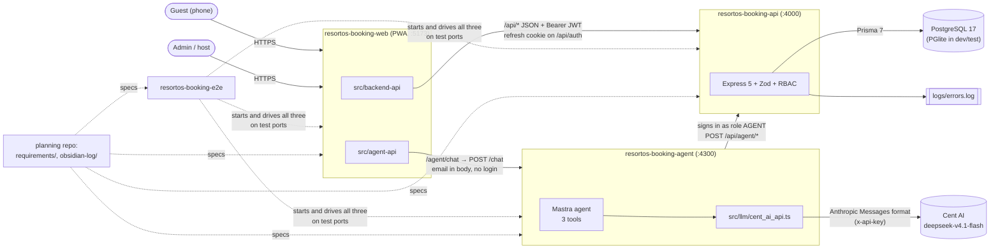
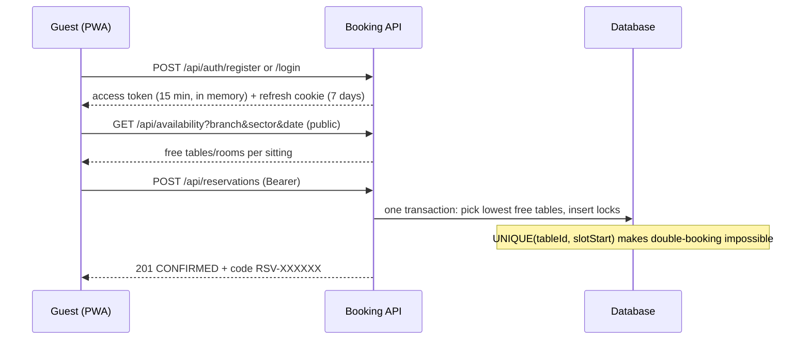
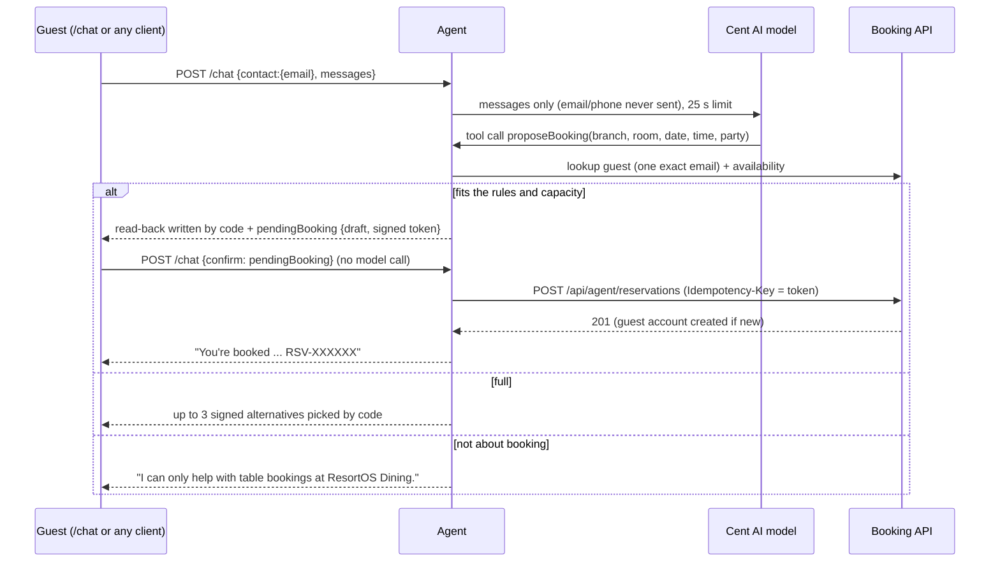
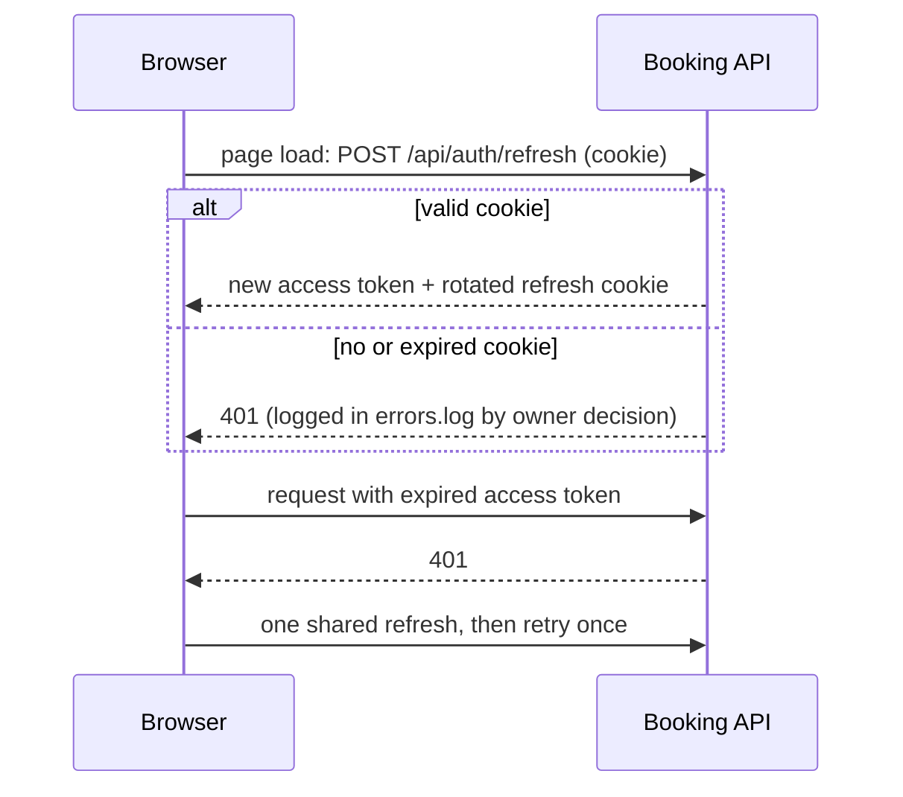

# ResortOS Dining: How the Repos Fit Together

Five git repositories in one folder. The **booking API** is the source of truth; the **web app** and the **assistant** are clients of it, and the **e2e suite** drives all three.

## 1. System map

| Repo | Role | Dev port | Test port (e2e) |
|---|---|---|---|
| `resortos-booking-api` | Bookings, accounts, rules, RBAC, audit, failure log | 4000 | 4400 (DB 5433) |
| `resortos-booking-web` | Mobile-only PWA for guests and admins, plus the chat screen | 5173 | 5190 |
| `resortos-booking-agent` | AI booking assistant (HTTP only) | 4300 | 4500 |
| `resortos-booking-e2e` | Real end-to-end tests, videos, `RESULTS.md`, load test | n/a | n/a |
| root (planning) | `requirements/` specs, `obsidian-log/`, this file | n/a | n/a |

Each repo keeps **its own types** (`src/types/`); nothing is shared at compile time, only HTTP contracts from `requirements/api_spec.md`.

## 2. Guest books in the app

## 3. Guest books through the assistant

## 4. Sessions and tokens

> **APPROVED 2026-11-03, NOT YET IMPLEMENTED (next session); the diagram below is the current behaviour: simpler sessions.**
> * Guests and admins: **one HttpOnly session cookie, fixed 1 hour from sign-in** (not extended by activity), then signed out. `SameSite=Lax`, `Secure` in production. No access token in memory, no refresh token, no `/api/auth/refresh`, no `ACCESS_TOKEN_TTL`.
> * PWA: **no idle timer.** When the session ends, screens keep the data they already show; the next server call returns 401 and the app goes to sign-in.
> * AI assistant: a **predefined API key** (`AGENT_API_KEY`) created at seeding; only its hash is stored. Sent as `X-Agent-Key`; maps to role `AGENT` with the same two permissions. No agent password.
> * Keep CSRF safe with `SameSite=Lax` + the CORS origin rule, and add a test for it. Update api_spec.md, DIAGRAM.md, READMEs and every test helper that sends `Authorization: Bearer`.

## 5. Choices and peculiarities (on purpose, for simplicity)

**Bookings**
* **Automatic acceptance (RSVP):** a booking is `CONFIRMED` the moment it's made. No host approval step, no email verification link.
* **Fixed 2.5-hour sittings** at 11:00, 13:30, 17:00, 19:30 (restaurant time, **UTC+7**). Two bookings overlap only if they share a sitting, so no time-range maths.
* **Tables are assigned automatically:** Main Hall joins ⌈party ÷ 2⌉ two-seat tables (50 per branch); VIP merges ⌈party ÷ 13⌉ of 4 private rooms. Guests can't pick tables.
* Party size **1 to 50**; bookable from now up to **60 days** ahead; changes and cancels only before the sitting starts.
* **Soft cancel:** status becomes `CANCELLED`, tables are freed, the record stays.
* The app only ever writes `CONFIRMED` and `CANCELLED`. `SEATED`, `COMPLETED`, `NO_SHOW` exist for a future host-stand app (test data uses them).
* Booking codes look like `RSV-7K3Q9X` (no 0/O/1/I).

**People and roles**
* Three roles: **USER** (own bookings), **ADMIN** (read-only everything, can't create bookings), **AGENT** (the assistant: book on a guest's behalf, read one guest by exact email, nothing else).
* Another guest's booking answers **404**, never 403, so IDs can't be probed.
* **Anonymous assistant guests:** an email is enough. A **password-less guest account** is created for it; signing up later with that email **claims** the account and its bookings.
* **Limits per email (assistant):** **1** upcoming booking until the email signs up, **3** after. Asking for more tells the guest to sign up, cancel the existing booking in the app, then ask again. The assistant **never cancels**, because the chat email is unverified.

**Assistant specifics**
* Booking topics only. Anything else gets a fixed refusal; the topic (not the message) is logged.
* The model can only check availability, draft a booking or flag "not supported". **It can't book**: only a guest's confirmation of a **signed draft** (HMAC, 15 minutes) books, and the token doubles as the idempotency key so retries never double-book.
* Read-backs, confirmations, alternatives, refusals and limit messages are written **by code**, not the model.
* Rate limits: 10 chats/min per IP, 3 confirmations/hour per IP, 30 chats per 30 minutes per email.
* Cent AI via the **Anthropic Messages** format (about 3× fewer input tokens than Responses). DeepSeek's unsigned "thinking" blocks are dropped before the AI SDK sees them. Each turn has a **25 s** limit.

**Platform**
* Sessions: 15-minute access token in memory, 7-day refresh cookie (HttpOnly, rotated). No server-side revocation list yet.
* **PWA:** installable, works offline for the app shell only; booking data is always live.
* Mobile-only layout; English only; prices shown as `Rp 320.000` on every browser.
* **Failure log:** every 4xx/5xx is one JSON line in `logs/errors.log` (no bodies, passwords or query strings), rotated at 5 MB, 3 old files kept.
* **Audit log** is append-only, enforced by a database trigger.
* Dev and tests run on **PGlite** (embedded Postgres); race tests and production use **real PostgreSQL** (`npm run test:pg`).
